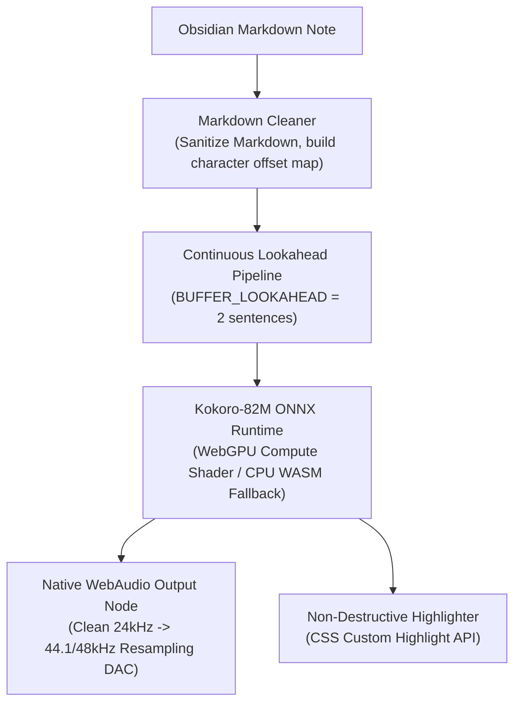

# let's hear it 🎧
> **Listen to your notes without leaving your vault.**  
> **Zero setup overhead. Zero API keys. Instant, private speech powered directly by your device.**

[](https://opensource.org/licenses/MIT)
[](https://obsidian.md)
[](#privacy--network-disclosure)

---

## The Fastest Way to Hear Your Notes

Most text-to-speech tools for Obsidian demand a compromise: either pay for monthly cloud subscriptions and send your private notes over the internet, or spend an afternoon configuring Python environments, Docker containers, and external command-line daemons.

**let's hear it** eliminates the setup overhead entirely. 

It embeds an optimized neural speech engine directly into Obsidian's Electron runtime. It taps your computer's graphics hardware (WebGPU) or CPU (WASM SIMD) to synthesize natural, fluid speech on demand. 

You install the plugin, open a note, and press play.

---

### What Makes It Different?

| Feature | Cloud API Plugins | External Local Engines (Piper/Docker) | **let's hear it** |
| :--- | :--- | :--- | :--- |
| **Setup Overhead** | Requires API accounts & billing setup | Complex terminal setup & external binaries | **Zero setup (Plug & Play)** |
| **Vault Privacy** | Notes sent to remote third-party servers | Local | **100% On-Device (Zero data leaves)** |
| **Playback Latency** | Network delay on every request | Fast | **Instant (Streaming sentence pipeline)** |
| **Recurring Cost** | Pay per character / monthly tokens | Free | **100% Free & Open Source** |
| **Highlight Tracking**| Often lacks editor integration | Rare | **Real-time word & sentence tracking** |

---

## Everyday Workflows: How You'll Use It

### 1. Instant Neural Speech & Live Word Tracking
Tired of staring at text after a long day? Enable **Hearing Mode**. The plugin automatically shifts your active note into a clean Reading View, keeping the active sentence smoothly centered while tracking every spoken word in real time. 

When you read your own writing on screen, your eyes gloss over typos. When you listen to your note read out loud with live highlight tracking, stumbles and rhythm issues surface immediately.

<p align="center">
  <video src="https://raw.githubusercontent.com/drawablex86/lets-hear-it/master/ux-vids/live-tts.mp4" width="100%" controls>
    <a href="https://raw.githubusercontent.com/drawablex86/lets-hear-it/master/ux-vids/live-tts.mp4">▶ Watch Live Neural Speech Demo (live-tts.mp4)</a>
  </video>
</p>
<p align="center"><sub>🎬 <b>Live Demo:</b> Instant playback start, floating audio dock, and zero-drift word highlighting.</sub></p>

### 2. Read Only What Matters: Selected Text on Demand
Need to review just a single section, quote, or draft paragraph of a long research note? Highlight the exact text you want to hear, right-click, and select **Read selection** (or trigger the command palette). The engine synthesizes only the selected text and leaves the rest alone.

<p align="center">
  <video src="https://raw.githubusercontent.com/drawablex86/lets-hear-it/master/ux-vids/highlighted-text-only-tts.mp4" width="100%" controls>
    <a href="https://raw.githubusercontent.com/drawablex86/lets-hear-it/master/ux-vids/highlighted-text-only-tts.mp4">▶ Watch Selection Playback Demo (highlighted-text-only-tts.mp4)</a>
  </video>
</p>
<p align="center"><sub>🎬 <b>Live Demo:</b> Highlight any passage and synthesize only what you need without losing your place.</sub></p>

### 3. Turn Vault Notes into Offline MP3s with One Click
Convert any note or selected passage into a high-quality MP3 audio file saved directly into your vault folder. The export tool automatically names recordings from your note headings or snippets, letting you take your notes on walks or morning commutes.

<p align="center">
  <video src="https://raw.githubusercontent.com/drawablex86/lets-hear-it/master/ux-vids/mp3export.mp4" width="100%" controls>
    <a href="https://raw.githubusercontent.com/drawablex86/lets-hear-it/master/ux-vids/mp3export.mp4">▶ Watch MP3 Export Demo (mp3export.mp4)</a>
  </video>
</p>
<p align="center"><sub>🎬 <b>Live Demo:</b> One-click high-bitrate MP3 export saved directly into your Obsidian vault.</sub></p>

---

## Features Built for Daily Flow

- ⚡ **Instant-Start Sentence Pipelining**: You never have to wait for a 10-page document to finish synthesizing. The engine starts playing the very first sentence within milliseconds, then pre-buffers upcoming lines in the background.
- 🗣️ **28 Distinct Neural Voices**: Choose between natural American and British male and female voices (warm conversational, sharp narrative, steady podcast, and relaxed tones).
- 🎯 **Non-Destructive Word Highlighting**: Uses the modern, browser-native **CSS Custom Highlight API** to trace the active word and sentence in real time. It never alters your note's markdown source, never wraps text in dirty HTML `<span>` tags, and never triggers vault file-sync noise.
- 🎛️ **Floating Audio Dock**: A discreet floating bar that stays out of your way while giving you instant access to Play/Pause, Replay, Playback Speed (`0.75x` – `2.0x`), Voice switching, and Sentence navigation.
- 🧹 **Intelligent Markdown Cleaner**: Automatically silences YAML frontmatter, Obsidian `[[wiki-links]]`, URLs, code snippets, math equations, and Markdown formatting syntax (`**bold**`, `*italics*`, `> callouts`). You hear natural English prose, not raw punctuation.

---

## How to Use

1. **Open any English markdown note** in Obsidian.
2. **Start playback**:
   - Click the **Ear icon** in the left ribbon to read the entire note.
   - Or **select specific text**, right-click, and choose **Read selection**.
   - Or open the Command Palette (`Ctrl/Cmd + P`) and type `let's hear it: Read current note`.
3. **Control playback**: Use the floating audio bar at the bottom to adjust reading speed, pause, or switch voices on the fly.

> [!NOTE]
> **Language Support**: *let's hear it* is currently tailored for **English notes** (with 28 American and British voices). Additional languages will be explored in future releases.

---

## Architecture & Technical Deep-Dive

For developers, contributors, and technical reviewers interested in how local inference runs cleanly inside Obsidian:



### 1. WebGPU Compute with Automatic CPU Fallback
By default, the plugin initializes via **WebGPU**, dispatching tensor matrix multiplications directly to your device's graphics shaders. This achieves near-instant synthesis with studio-clean fp32 precision while leaving the Obsidian UI thread completely responsive. 

If WebGPU is not supported by your hardware or platform, the engine automatically falls back to multi-threaded **CPU WASM SIMD** without interrupting the user.

### 2. Gapless Playback over Compound Sentences
To prevent choppy delays between long or compound sentences, the synthesizer utilizes a continuous 2-sentence sliding lookahead queue (`BUFFER_LOOKAHEAD = 2`). Synthesis for the next sentence is pre-emptively calculated while the current audio buffer is actively playing through the WebAudio DAC.

### 3. Memory Lifecycle & V8 Cooperative Sweeps
Running local neural networks in long-lived desktop applications requires strict memory hygiene:
- Every intermediate token embedding tensor is explicitly disposed of after inference.
- An idle, debounced V8 garbage collection sweep (`scheduleBackgroundGCSweep`) triggers between sentences and during pauses, preventing memory growth and eliminating GPU memory leaks.

### 4. Electron Sandbox & Origin Handling
Obsidian runs inside an Electron environment under custom origin schemes (`app://` and `file://`), which normally block external WebAssembly dynamic module imports:
- **Base64 Data URL ESM Loader**: Custom esbuild transforms serialize local `.mjs` loader scripts into memory-mapped `data:text/javascript;base64,...` modules to comply with Chromium sandbox origin restrictions.
- **Hardware Sample Rate Matching**: Rather than forcing a hardcoded sample rate on `AudioContext` (which can cause CoreAudio clicks and distortion on macOS), the audio pipeline runs at the host system's native hardware rate (44.1kHz or 48kHz) and uses WebAudio's internal resampling algorithms for clean sound reproduction.

---

## Privacy & Network Disclosure

*let's hear it* is designed to adhere strictly to the **Obsidian Community Plugin Guidelines**:

1. **Zero Telemetry & 100% Offline Operation**: The plugin contains no tracking code, telemetry, or analytics. Your notes, reading habits, and synthesized audio never leave your local device.
2. **One-Time Model Asset Download**: To avoid bloating the vault repository download size, the quantized Kokoro ONNX model weights (`kokoro-v1.0.onnx`, ~80MB) and voice embedding files are fetched once from HuggingFace (`https://huggingface.co/onnx-community/Kokoro-82M-v1.0-ONNX`) on first use and cached permanently in local browser storage (IndexedDB). Once downloaded, all synthesis is completely offline.
3. **Filesystem Boundaries**: The plugin reads and writes files solely within its own plugin folder (`.obsidian/plugins/lets-hear-it/`) for pre-bundled WebAssembly binaries and within the user-specified vault folder when exporting MP3 audio. It never accesses or modifies files outside these boundaries.

---

## Automated Verification & Headless Testing

The repository includes a comprehensive headless test runner that simulates Obsidian's runtime environment, WebAudio graphs, and neural inference:

```bash
# Run the automated Obsidian simulation test suite
node test-obsidian-simulator.mjs
```

What the simulator verifies:
- WebAudio PCM buffer integrity (asserts **0 NaN values** and valid dynamic amplitude).
- Sentence chunking and word-level character offset mapping.
- Setting tab declarative search indexing (`getSettingDefinitions()`).
- Player state transitions, loop restarts, and memory cleanup.

---

## Development

```bash
# 1. Clone repository
git clone https://github.com/drawablex86/lets-hear-it.git
cd lets-hear-it

# 2. Install dependencies
npm install

# 3. Build production bundle (outputs main.js, styles.css, manifest.json)
npm run build
```

---

## License
[MIT](LICENSE)
